# Build loop chart

<!-- Generated by packages/contracts/scripts/build-loop-chart.ts. Do not edit by hand. -->

This file draws the steps of the build loop as charts. The steps themselves
are written in [the build loop design](2026-11-05-build-loop-design.md#the-steps-in-each-phase),
and that text is the source. A script makes this file from it, and a test
fails when this file is out of date. GitHub draws each chart from its Mermaid
source. Run `node packages/contracts/scripts/build-loop-chart.ts` after
changing a step.

## How to read the charts

- A rounded box is a state the work is in.
- A diamond is a decision.
- A pill is where a chart starts, or another phase the work moves to.
- A plain arrow is an action an agent or a script takes.
- A thick arrow is an action the owner takes.
- A dotted arrow is an action that reaches the owner only when needed.

## The phases and the moves between them

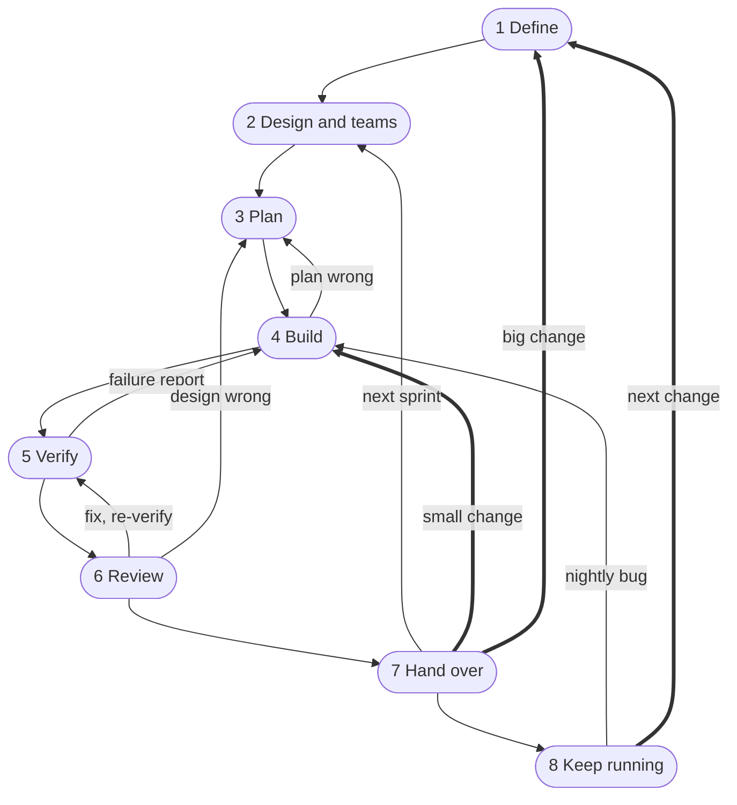

## 1 Define

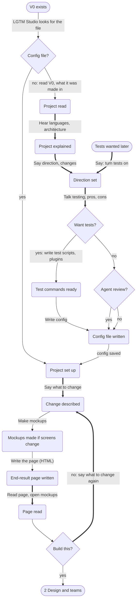

## 2 Design and teams

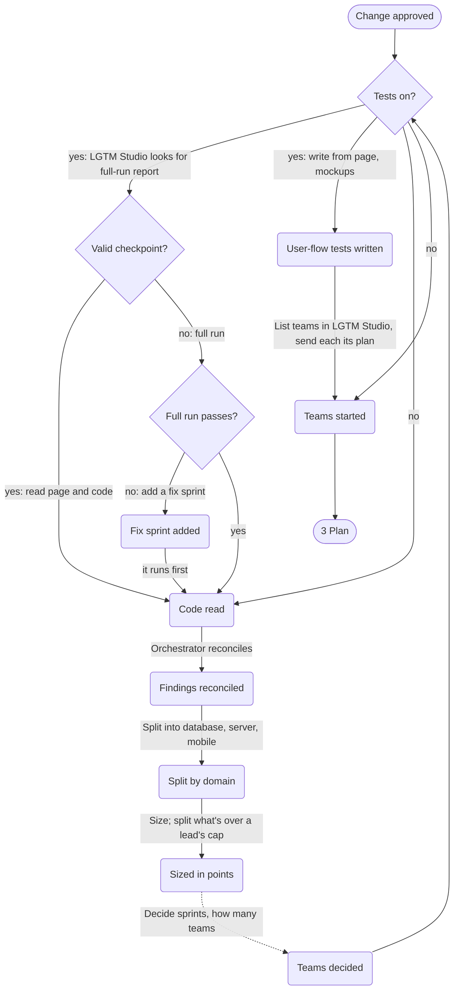

## 3 Plan

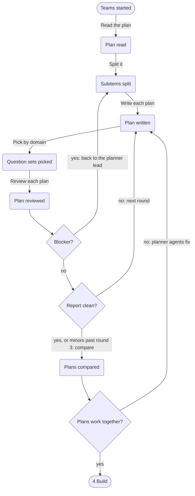

### Block: Write each plan

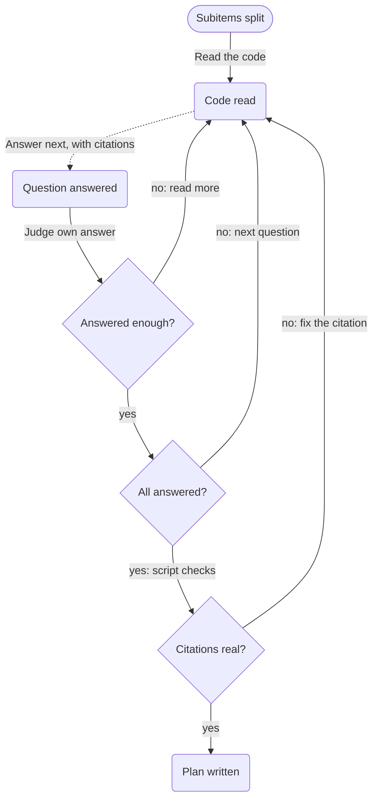

### Block: Review each plan

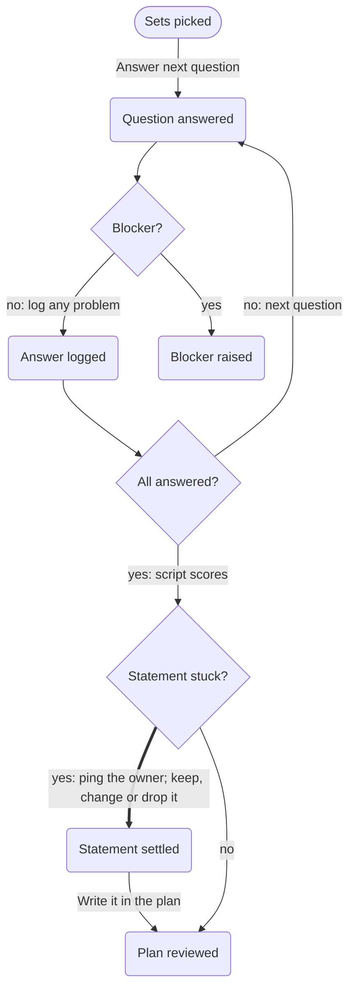

### Block: Next round

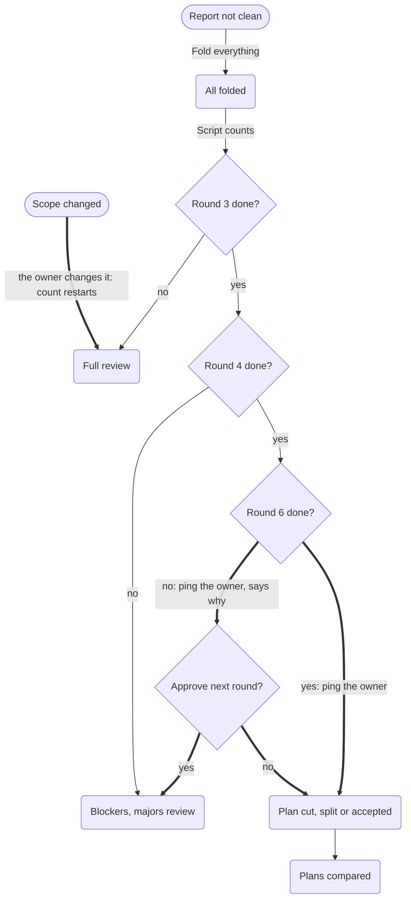

## 4 Build

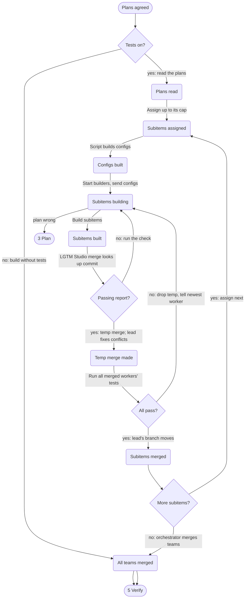

### Block: Build subitems

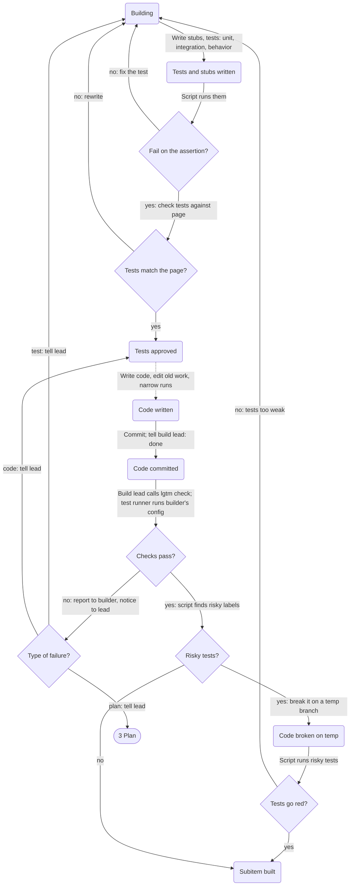

### Block: Build without tests

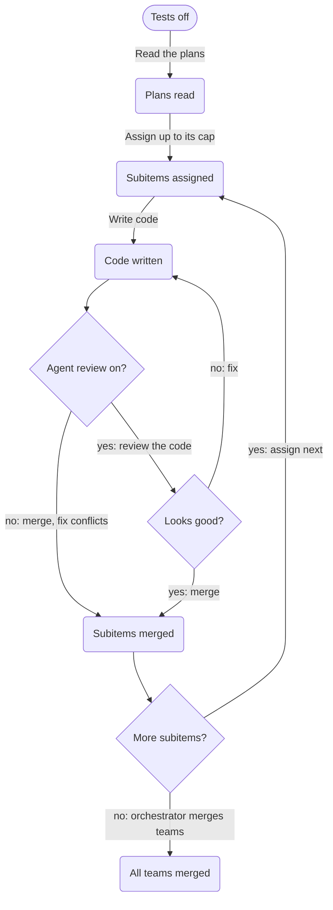

### Block: Fix team

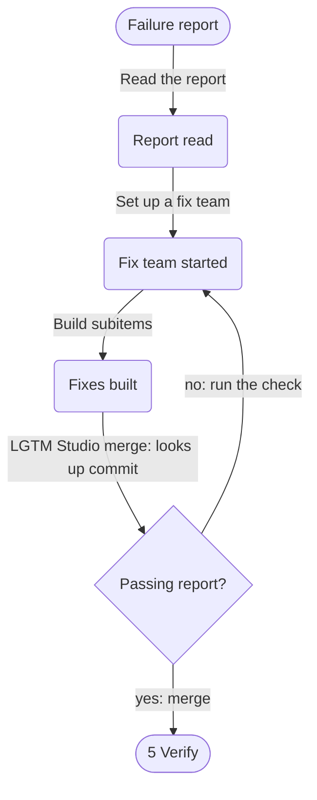

## 5 Verify

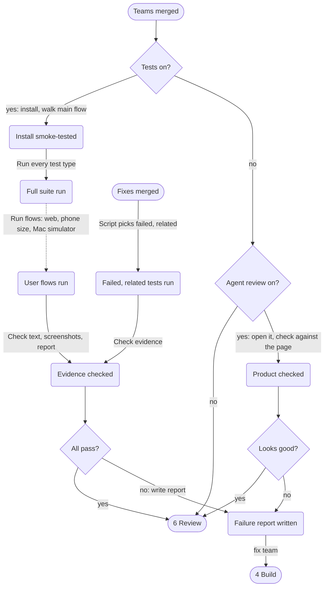

## 6 Review

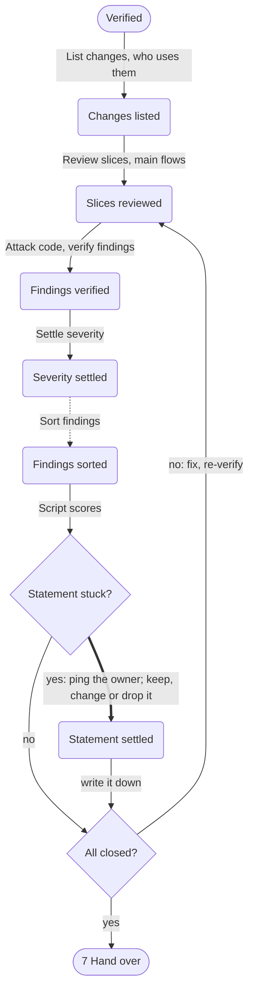

## 7 Hand over

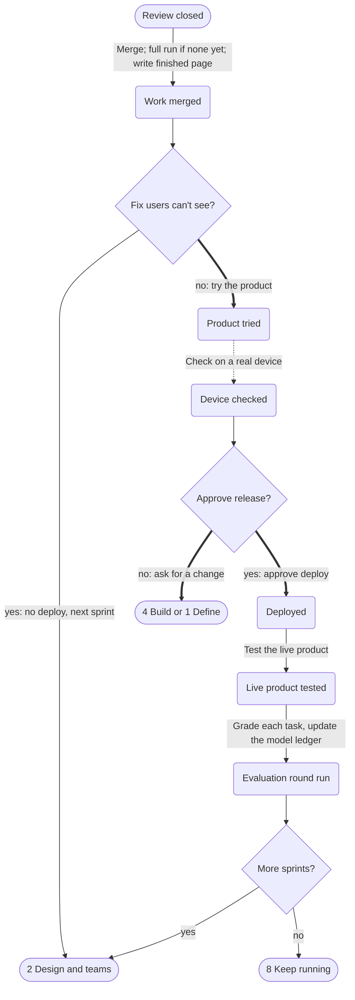

## 8 Keep running

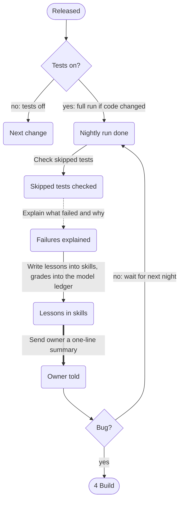
